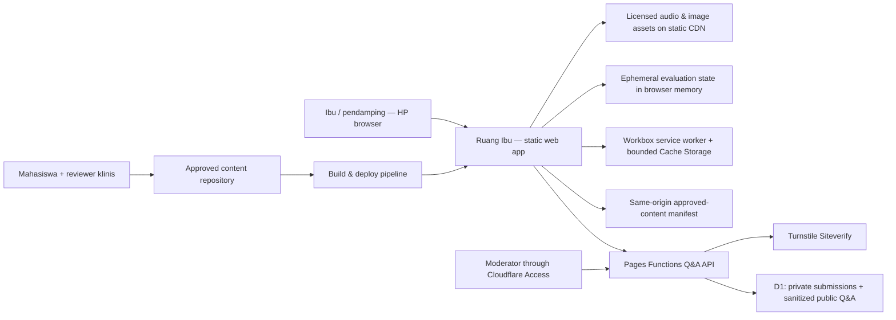
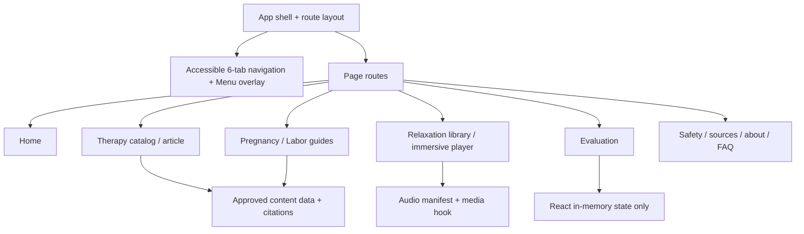
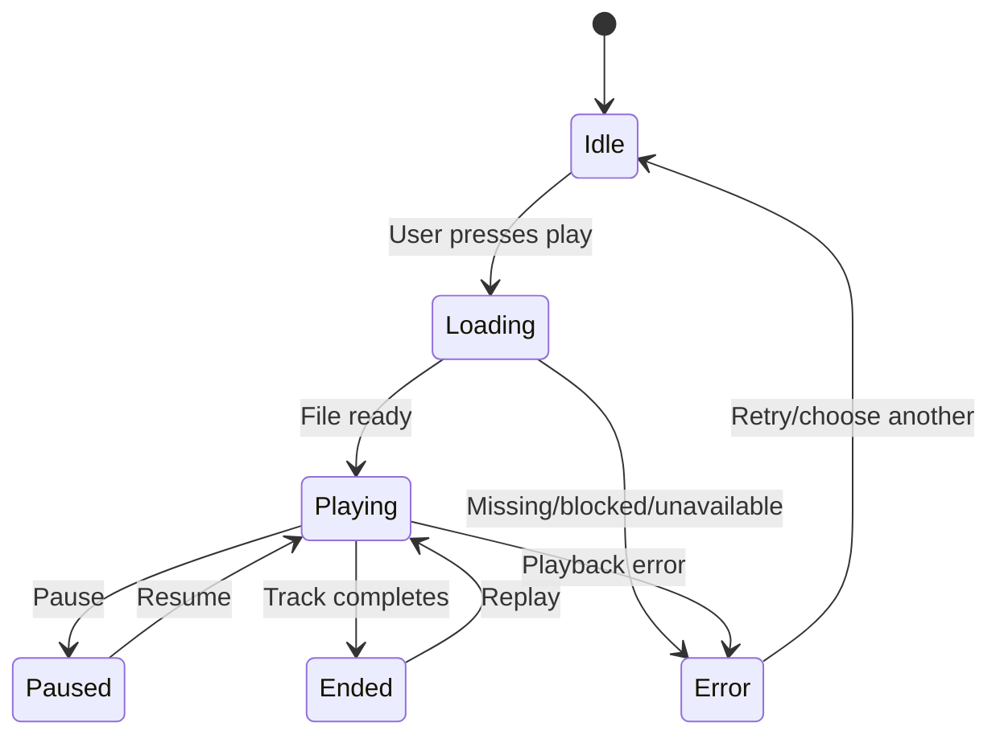

# RUANG IBU — Software Architecture v1.1

**Status:** baseline frontend architecture plus M3 local Cloudflare Pages Functions/D1 Q&A foundation; remote Cloudflare resources remain unprovisioned.
**Source references:** `01-DESIGN-SYSTEM.md`, `02-PRD.md`, approved mobile collage.  
**Guiding principle:** static content-first mobile web; add backend only for the reviewed, consent-based Q&A requirement. Evaluation stays ephemeral.

## 1. Architecture decision

The public application uses **React + TypeScript + Vite + Tailwind CSS + React Router + `vite-plugin-pwa`** and static Cloudflare Pages assets. Workbox `injectManifest` keeps cache admission, article invalidation, and audio behavior explicit. Native HTML5 `<audio>` provides playback. Reviewed Q&A APIs run in Cloudflare Pages Functions and use D1 for question records, answers, moderation events, and short-lived HMAC rate-limit buckets. Cloudflare Turnstile protects visitor submissions; Cloudflare Access JWT verification protects admin APIs. No visitor accounts, automated clinical answers, analytics of health data, or persisted evaluation scores are added. Local M3 functions/tests exist; remote Preview/Production bindings and secrets are not configured.

### C4-like context diagram



No arrow to external collection service or clinical decision engine: these are explicitly out of scope.

### Component topology



## 2. Technology matrix and rationale

| Layer | Choice | Rationale / limit |
|---|---|---|
| Language | TypeScript strict mode | safer content and UI contracts |
| UI | React 19-compatible + Vite | static bundle, no server needed for MVP |
| Styling | Tailwind CSS + tokens CSS | component styling without generic UI template |
| Routing | React Router | six canonical destinations + article/media detail |
| Icons | Phosphor Icons for React | Light inactive and fill active weights; a small custom maternity SVG covers the missing pregnancy silhouette. Existing brand mark remains unchanged. |
| Typography | Fraunces + DM Sans (working approximation) | serif editorial headings, clear body; QA against master screenshot |
| Audio | `<audio>` HTMLMediaElement + React hook | natural browser controls, no streaming backend |
| Content | typed TS/JSON or Markdown compiled at build time | citation traceability and prepublication review gates |
| Testing | Vitest + React Testing Library + Playwright + axe-core | component, route, accessibility and visual tests |
| Hosting | Cloudflare Pages / Vercel static | simple deployment; HTTPS and caching |
| PWA | `vite-plugin-pwa` + Web App Manifest + Workbox `injectManifest` | install metadata and controlled offline shell/content/audio caching; API excluded |
| Offline content | same-origin content manifest + versioned approved articles | detect and remove superseded content when online; offline content is visibly time-bounded |
| Storage | Workbox Cache Storage for approved static/audio only; D1 for Q&A | evaluation remains memory-only; API results are no-store and not cached |
| Monitoring | build error logs, optional privacy-respecting coarse site status | no assessment/user health tracking |

## 3. Proposed repository layout

```
ruang-ibu/
├── docs/
│   ├── 01-DESIGN-SYSTEM.md
│   ├── 02-PRD.md
│   ├── 03-ARCHITECTURE.md
│   ├── Fidelity-QA.md
│   └── Clinical-Review-Log.md
├── reference/
│   ├── MASTER-mobile-approved.png
│   └── screens/01-beranda.png ... 08-menu.png
├── assets/
│   └── ASSET-LICENSE-MANIFEST.md
├── public/
│   ├── images/           # individually licensed, optimised images (not screenshots)
│   └── audio/            # individual reviewed/licensed files; no silent placeholder
├── src/
│   ├── app/App.tsx
│   ├── app/router.tsx
│   ├── components/layout/{Header,BottomTabBar,MenuOverlay}.tsx
│   ├── components/ui/{ActionPill,FilterChips,TherapyRow,AudioRow}.tsx
│   ├── components/safety/{SafetyNotice,ReviewStatus}.tsx
│   ├── features/therapies/{TherapyCatalog,TherapyDetail}.tsx
│   ├── features/guides/{PregnancyGuides,LaborGuides}.tsx
│   ├── features/audio/{AudioLibrary,ImmersivePlayer,useAudioPlayer}.tsx
│   ├── features/evaluation/{EvaluationForm,useEphemeralAssessment}.tsx
│   ├── pages/{HomePage,SafetyPage,SourcesPage,AboutPage,FaqPage}.tsx
│   ├── content/{therapies,guides,audioManifest,references}.ts
│   ├── styles/{tokens,global}.css
│   ├── types/{content,audio,evaluation}.ts
│   └── tests/
├── e2e/
├── package.json
└── vite.config.ts
```

### PWA module additions to the proposed repository layout

```text
public/pwa-icons/                 approved standard, maskable and iOS icons
public/content-manifest.json      published content revisions and withdrawals
public/content/articles/           separately deployable immutable article revisions
src/pwa/service-worker.ts         Workbox routes, cache limits and invalidation
src/pwa/update-controller.ts      app-shell update prompt and offline-ready state
```

## 4. Content models

```ts
type ReviewStatus = 'draft' | 'in_review' | 'clinically_approved';
type Audience = 'third_trimester' | 'labor' | 'companion';

interface Citation {
  id: string;
  title: string;
  publisher: string;
  url: string;
  publicationYear?: number;
  accessedOn?: string;
}

interface EducationalArticle {
  slug: string;
  title: string;
  summary: string;
  audience: Audience[];
  headings: Array<{ id: string; title: string; blocks: string[] }>;
  sourceIds: string[];
  safetyNote: string;
  review: {
    status: ReviewStatus;
    reviewerName?: string;
    reviewerRole?: string;
    reviewedAt?: string;
  };
}

interface AudioTrack {
  slug: string;
  title: string;
  category: 'music' | 'nature' | 'guided';
  src?: string; // absence means unavailable, NOT fake playback
  artwork: string;
  transcript?: string; // required for narrated tracks
  allowAmbientLoop: boolean;
  durationSec?: number;
  license: {
    creator: string;
    title: string;
    sourceUrl: string;
    licenseId: string;
    attributionRequired: boolean;
  };
  scriptReviewStatus?: ReviewStatus; // for guided narration
}

interface AssessmentSnapshot {
  comfort: number; // 0: very uncomfortable, 10: very comfortable
  anxiety: number;  // 0: no anxiety, 10: highest subjective anxiety
  stage: 'before' | 'after';
}

interface PublishedContentManifest {
  version: string;
  publishedAt: string;
  articles: Array<{
    slug: string;
    revision: string;
    sha256: string;
    status: 'clinically_approved' | 'withdrawn' | 'superseded';
    reviewedAt?: string;
    updatedAt: string;
  }>;
}
```

**Gate on rendering:** in public/production context, draft/in_review content is displayed only as a clearly labeled preview with directive steps disabled or omitted. `clinically_approved` is a published editorial status, not a certification or a promise of safety for every individual.

## 5. State management

- Shared navigation: React Router, no custom global routing state.
- Media: `useAudioPlayer` / context shared only within audio feature; state `idle | loading | playing | paused | ended | error` with one active track; cleanup listeners + pause on unmount.
- Evaluation: `useState`/feature context with temporary before/after snapshots; **no `localStorage`, sessionStorage, cookies, API call, analytics events, or export** for assessment MVP.
- Filters: local route search parameters optionally (`?kategori=hamil`) without personal identifiers.
- Modal menu: local open state with focus trap, scroll lock, Escape, restore focus.

## 5.1 PWA manifest, installability, and offline cache contract

- Configure `vite-plugin-pwa` with Workbox `injectManifest`; compile a project-owned service worker that imports Workbox routing, strategies, expiration, cacheability, and range-request modules. Precache only the versioned app shell and essential small assets. Do not precache the full article catalog or audio files.
- Provide a stable Web App Manifest with `id`, `name`, `short_name`, `start_url: "/"`, `scope: "/"`, `display: "standalone"`, `theme_color`, `background_color`, and standard/maskable 192x192 and 512x512 icons. Map theme/background colors from existing approved design tokens; do not change the palette. Include an iOS home-screen icon link and metadata. Icons must be owned/approved assets; they do not authorize a change to the approved in-product design.
- Android: serve over HTTPS and validate the browser-native install flow on supported Android browsers. Do not assume `beforeinstallprompt` is available in every browser. iOS/iPadOS: installation is user-initiated through the browser's Share / Add to Home Screen interface; document the path when needed and do not promise a universal native install prompt. No new tab, dashboard, fake OS chrome, or required install interstitial is introduced.
- Shell assets: versioned precache with Workbox cleanup of outdated precache entries. The install/update must not cache reference screenshots as interface content.
- Approved articles: use a named Workbox `NetworkFirst` cache (3-second network timeout) with `ExpirationPlugin` limits of `maxEntries: 50` and `maxAgeSeconds: 7 * 24 * 60 * 60`. Admit only same-origin, published `clinically_approved` article revisions. Store each article's approved revision/hash and last successful online verification time. A UI gate, independent of Workbox cache expiration, withholds directive instructions if that verification is older than 7 days; show a stale/offline notice and an appropriate contact-care-team reminder. Draft and in-review content never enters this cache.
- Content manifest: fetch the same-origin manifest with `NetworkFirst`, a short timeout, `maxEntries: 1`, and a 5-minute expiration/recheck window. Check at app startup and when a visible app resumes. When online and a manifest marks a cached article withdrawn or superseded, delete that article revision before showing its instructions; fetch the separate immutable article payload and verify its SHA-256 hash against the manifest before rendering it. Preserve manifest `version`, `publishedAt`, article revision/hash, review status, and withdrawal data as metadata. If offline, show the last successful check time; never claim the cache reflects the latest clinical review. A device that remains offline cannot receive a withdrawal, so offline availability is bounded and explicitly qualified.
- Offline audio: downloading is an explicit user action and only available for licensed tracks with approved metadata. Fetch/cache the complete file before marking it available offline. Use a separate cache with application-enforced limits of 20 MiB per file, 3 tracks maximum, and 50 MiB total; expire after 30 days (`maxAgeSeconds: 30 * 24 * 60 * 60`) and provide a remove control. Workbox `ExpirationPlugin` enforces entry count and age; app code tracks byte totals, checks the saved download time before enabling offline playback, and rejects writes over the aggregate/per-file budget. Do not silently delete another selected track. Use `RangeRequestsPlugin` to support seeking from a fully cached response and configure the media element for CORS as required by Workbox. Streaming playback is not treated as an offline download.
- On quota errors, failed full-file downloads, browser eviction, or unsupported storage APIs, keep online playback available when possible, show an accurate unavailable-offline state, and offer cache removal/retry. Use `navigator.storage.estimate()` when available, but do not treat its estimate as a reservation. Cache Storage is best-effort and may be cleared by the browser or user; never promise permanent retention.
- App-shell updates use the plugin's prompt behavior, not forced auto-update. Offer "Perbarui" and "Nanti" using existing semantic components and current design tokens; do not change the visual system. Defer reload while a form is active or audio is playing, and restore the current route after update when possible. Clinical content manifest changes are independent of app-shell updates, so approved corrections and withdrawals do not require visual redesign or a new app-shell release.
- Never put evaluation values, personal data, API responses containing user data, or third-party requests in the service-worker cache. Service worker registration, update errors, and unsupported/offline conditions must degrade to the ordinary website.

## 6. Audio lifecycle / edge cases



- Respect browser user-gesture requirement; never autoplay.
- Play/pause and seek work with screen readers and keyboard.
- Time presets 15/30/60 minutes only for **ambient recordings** that can loop; this is session timer, not guaranteed audio runtime. Guided narration uses real finite duration and no forced loop.
- Volume starts conservatively; do not override device hardware volume.
- Missing file displays explicit disabled/error state.
- Audio should not be presented as medical treatment and should not interfere with care-team communication.

## 7. Evaluation design and safety

```
User moves 0–10 comfort slider + 0–10 anxiety slider
       ↓
local React state, no submit network request
       ↓
optional 'Simpan untuk sesi ini' (memory only)
       ↓
optional second score and descriptive comparison
       ↓
when page reloads, browser discards scores
```

Show 'perubahan persepsi yang Anda laporkan selama sesi ini', not 'terapi terbukti efektif'. Do not use a standard anxiety/obstetric clinical instrument name unless appropriate permission, validated Indonesian version, and protocol exist. If lecturer requests downloadable survey data, redesign privacy/security/consent separately.

## 8. Asset and content governance

- `assets/ASSET-LICENSE-MANIFEST.md`: every production photo, illustration, icon customization, and audio must have provenance. Unknown license => cannot ship.
- `docs/Clinical-Review-Log.md`: article ID, revision, reviewer qualifications, reviewed date, exact approved revision hash. Do not change approved stepwise instructions without renewed review.
- Automatic build validation: reject production audio without license/creator/source metadata; reject public clinical step-by-step article not approved.
- Use source text in reference markdown only as draft scaffold; validate citations and clinical language before publishing.

## 9. Security/privacy posture

- Q&A stores only visitor-submitted display name, question and optional email plus moderator-approved public text and answer. No visitor account, diagnosis, or automatic response. HTTPS only. Security headers include `X-Content-Type-Options: nosniff` and `Referrer-Policy`; avoid overly permissive third-party embed scripts.
- Admin API verifies Cloudflare Access RS256 JWT issuer/AUD/expiry and exact email allowlist; missing configuration fails closed. Visitor submission requires same-origin, server-side Turnstile, bounded validation and an HMAC-based D1 rate limit. See `docs/backend/SECURITY-MODEL.md`.
- Public API returns only moderator-approved fields and is `no-store`. Do not log payloads, emails, IPs, JWTs, or secrets. Cloudflare Preview and Production must use separate D1 and Turnstile configuration.
- No uploading user data. Avoid personal analytics, external error/session replay tools, and health details in URLs.
- Assets served from same-origin `/audio/` and `/images/` where possible; provide cache headers for immutable hashed assets.
- Do not infer health conditions from slider scores. Any future clinical features require separate threat model, consent, lawful basis, and professional review.

## 10. Performance and responsive strategy

- Optimized `avif/webp` source sets, correct `sizes`, optimized crop for hero; reserve intrinsic dimensions to avoid layout shift.
- Avoid fetching all audio upfront; preload `metadata` or `none`, lazy load media when tapped. Code-split player if needed.
- Local/self-hosted fonts where licensed; avoid blocking external trackers.
- Use fluid spacing/heading clamp sparingly and screenshot-test lines at 360/375/390/430 widths.
- Bottom tabs use web safe area and prevent obscuring last text/CTA. Immersive audio player uses no bottom navbar.
- Tablet/desktop follow-up: preserve editorial structure, widen image/text relationships; do not stretch a literal 390px phone mockup to large screens.

## 11. QA plan and CI gate

| Test kind | Must cover |
|---|---|
| Unit | content status filtering, audio track data guards, range value bounds, timer logic |
| Component | bottom navigation, filter chips, audio disabled/error, slider accessibility, menu focus |
| E2E | 6 menu routes, article/detail/sources, audio playback mock, keyboard nav, evaluation without storage |
| Visual | screenshot at 390×844 vs 8 reference crops; viewport 375 and 430 regression |
| Accessibility | axe checks + manual VoiceOver/TalkBack and keyboard focus checks |
| Governance | article source presence + reviewer status, audio license records, no cloud calls for evaluation |
| Smoke | public route direct reload, asset URLs, HTTPS, 404 fallback, no unauthorized drafts |
| PWA | manifest validity, icon sizes/maskable purpose, HTTPS/scope/start URL, service-worker install/activate, offline shell, offline approved article and 7-day stale gate, SHA-256 verification, withdrawn article invalidation, audio opt-in/full download/seek/3-track/20-MiB/50-MiB/30-day limits, quota error and browser-eviction fallback, update prompt and deferred reload, storage contains no evaluation data |
| Installability | Chrome Android eligible install and standalone launch; iOS Safari Add to Home Screen and standalone launch; unsupported-browser fallback; screenshot parity in browser and standalone at 390x844, 375x812, and 430x932 with no visual/IA drift from approved 6-tab reference |

## 12. Delivery sequence / incremental changes

- **Milestone 0:** create repo / add approved reference assets, docs and tokens; no replacement design.
- **Milestone 1:** implement homepage at 390px with real semantic components; user screenshot approval.
- **Milestone 2:** implement 02–05 lists/guides + menu, semantic page skeleton.
- **Milestone 3:** implement audio catalog/player with audited test tracks; replace when final licenses validated.
- **Milestone 4:** ephemeral evaluation and safety/reference pages; peer review.
- **Milestone 5:** responsive + accessibility + performance + visual regressions; clinical sign-off, then publish.
- **Milestone 6:** add PWA manifest/icons and Workbox service worker; validate installability, bounded article/audio caching, stale/withdrawn-content handling, and update behavior without changing the approved visual direction.

## 13. Design and architecture decisions (ADRs)

- **ADR-001 Static first with scoped Q&A:** static delivery remains the default; the approved moderated Q&A is the only M3 D1 collection. Evaluation remains ephemeral and independent.
- **ADR-002 Mobile screenshot lock:** source screenshot overrides generic generators; manual visual QA gate per screen.
- **ADR-003 No personal health collection:** ephemeral scores are not sent/stored.
- **ADR-004 Verified publication:** clinical instructions only after review, audio only after audit.
- **ADR-005 Six destination tabs:** explicitly honor approved UI even if many tabs; verify tap widths and a11y instead of silently replacing nav.
- **ADR-006 PWA without visual redesign:** `vite-plugin-pwa` + Manifest + Workbox are the official delivery/offline layer; the approved mobile composition, palette, and six-tab IA remain frozen.
- **ADR-007 Bounded offline medical content:** cache only clinically approved article revisions, expose last verification, withhold stale instructions after seven days, and invalidate withdrawals when online. Offline clients cannot receive revocations until reconnecting.
- **ADR-008 Explicit audio downloads:** only user-selected licensed files are cached, capped at 3 tracks / 20 MiB per file / 50 MiB total / 30 days; browser eviction remains possible.
- **ADR-009 Moderated Q&A:** Cloudflare Pages Functions + D1, Turnstile and Access; public text is separate from original submission, questions are never auto-published, and no custom visitor/admin password system is introduced.

## 14. Deployment checklist

- [ ] `npm run lint`, `typecheck`, `test`, `build` green.
- [ ] E2E and screenshot comparisons approved.
- [ ] Published content has references and documented clinical sign-off.
- [ ] All production images/audio rights verified and manifest complete.
- [ ] No sensitive analytics / external form submissions / local evaluation persistence.
- [ ] Navigation, focus, alt text, text zoom, captions/transcripts QA complete.
- [ ] Public URL and share preview tested on Android and iOS.
- [ ] Web App Manifest, standard/maskable icons, iOS home-screen metadata, HTTPS and service-worker scope validated.
- [ ] Install/add-to-home-screen flow tested on eligible Android and iOS versions; unsupported-browser fallback verified.
- [ ] Workbox shell/article/audio caches meet entry, age, byte and opt-in limits; quota failure and browser-cleared-cache behavior verified.
- [ ] Content manifest update, withdrawn/superseded article invalidation, seven-day stale gate, and deferred app-shell update prompt verified.
- [ ] No evaluation values or personal information appear in Cache Storage; offline notices do not imply current medical advice.

### PWA platform references

- [Vite PWA: minimal requirements and manifest](https://vite-pwa-org.netlify.app/guide/pwa-minimal-requirements)
- [Vite PWA: Workbox service-worker strategies](https://vite-pwa-org.netlify.app/guide/service-worker-strategies-and-behaviors)
- [Vite PWA: prompt for new content/update](https://vite-pwa-org.netlify.app/guide/prompt-for-update)
- [Workbox: cache expiration](https://developer.chrome.com/docs/workbox/modules/workbox-expiration)
- [Workbox: serving cached audio and video](https://developer.chrome.com/docs/workbox/serving-cached-audio-and-video)
- [MDN: making PWAs installable](https://developer.mozilla.org/en-US/docs/Web/Progressive_web_apps/Guides/Making_PWAs_installable)
- [MDN: storage quotas and eviction](https://developer.mozilla.org/en-US/docs/Web/API/Storage_API/Storage_quotas_and_eviction_criteria)
- [WebKit: Home Screen web apps and iOS/iPadOS support](https://webkit.org/blog/13878/web-push-for-web-apps-on-ios-and-ipados/)
